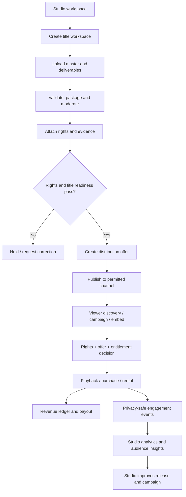
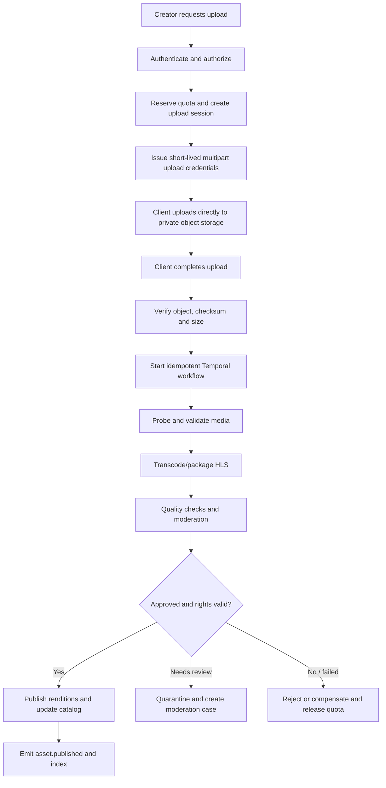
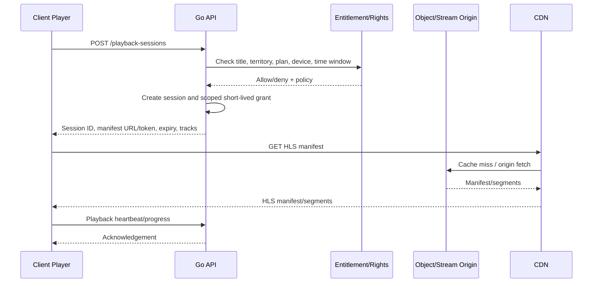
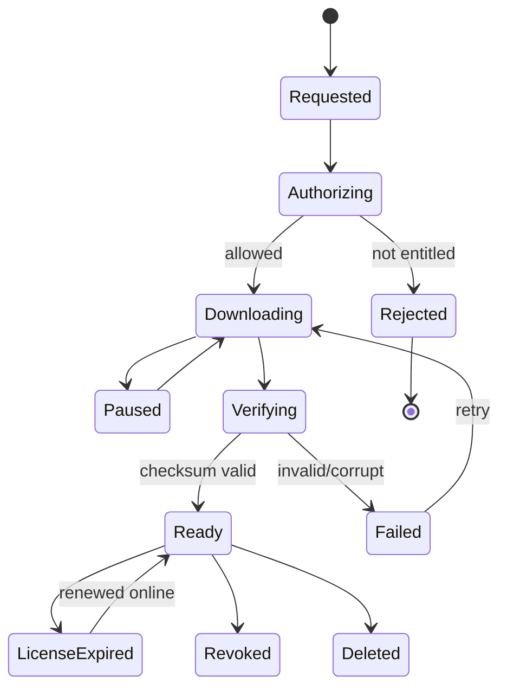

# ViewAura System Architecture Document

**Document status:** Proposed target architecture\
**Product:** ViewAura\
**Source baseline:** `README.md` supplied with the project\
**Audience:** Backend, client, platform, media, security, SRE and data
engineering\
**Version:** 2.0\
**Date:** 23 November 2026

------------------------------------------------------------------------

## 1. Purpose and architectural position

This document translates the supplied ViewAura README and the rewritten product strategy into an implementable architecture for an independent-film distribution and audience platform. It covers studio operations, rights-aware offers and release windows, multi-channel distribution, audience relationships, commercial analytics, streaming, offline resilience and secure media vaulting.

The architectural objective is not to create a separate microservice for every product surface. ViewAura Studio, ViewAura Watch and ViewAura Distribution are cohesive product experiences over shared title, rights, asset, offer, entitlement, audience and playback domains.

The governing decision is to **extend the existing architecture, not
replace it**:

-   Keep Go as the product-critical modular monolith for identity, studio tenancy, profiles, catalog, rights, distribution offers, audience relationships, ratings, reviews, watchlists, social, notifications, payments, entitlements, quotas, uploads, media assets, playback and moderation.
-   Keep PostgreSQL as the transactional system of record.
-   Keep Kafka for asynchronous domain events and downstream
    projections.
-   Keep Temporal for long-running upload, moderation, enrichment and
    deletion workflows.
-   Use Rust/Python satellite services only where their workload or
    ecosystem justifies a separate runtime.
-   Use Cloudflare's object storage/CDN/edge capabilities already named
    in the README, subject to a measured managed-versus-self-managed
    media decision.
-   Add client-side offline persistence and a native secure-download
    subsystem; these cannot be delivered by the current backend-only
    repository alone.

**Important status distinction:** The README says the Go core modules,
migrations, event publishing/outbox, three workflows and local
development stack are implemented. It also says some satellites are
scaffolds, workflow activities are not fully wired, BFF
subscriptions/federation are incomplete, DRM and Flink jobs are absent,
test coverage is thin, and native mobile apps are out of scope. This
architecture describes target behavior; it is not a claim that all
components currently work.

## 2. Architecture goals

1.  Securely ingest, validate, process, moderate and publish media.
2.  Deliver adaptive streaming with low startup time and predictable
    playback quality.
3.  Prevent unauthorized access to originals, manifests, segments,
    screeners and offline licenses.
4.  Support intermittent connectivity without corrupting user data.
5.  Support secure, licensed offline playback on explicitly supported
    clients.
6.  Separate creator originals, published renditions, screeners and
    viewer downloads.
7.  Make failure recovery durable and observable.
8.  Keep initial infrastructure and operational complexity proportionate
    to traffic.
9.  Preserve module boundaries and avoid distributed transactions where
    a local transaction is sufficient.
10. Make costs measurable per studio, title, upload, stored asset, processed source hour, delivered viewing hour and paid transaction.
11. Make studio publishing, rights, audience and revenue workflows valuable before consumer audience scale.
12. Support multiple distribution channels through one authorization and rights policy rather than duplicating business rules in each channel.
13. Preserve viewer privacy while enabling consent-based studio audience engagement and permitted data portability.

## 3. Logical architecture

``` text
                         CLIENT APPLICATIONS
       Web/PWA (online + cached metadata) | Native mobile (protected offline)
                           | REST / GraphQL / HLS
                           v
+------------------------------------------------------------------+
| Cloudflare Edge: WAF, bot controls, geo routing, cache, rate limit |
+-------------------------------+----------------------------------+
                                |
                                v
+----------------------- API / ACCESS LAYER -----------------------+
| Kong (production) / Go gateway (local)                            |
| JWT validation, request IDs, rate limits, circuit breakers        |
| GraphQL BFF (optional screen aggregation; REST remains canonical)|
+-------------------------------+----------------------------------+
                                |
                                v
+--------------------- GO MODULAR MONOLITH -------------------------+
| auth | user | profile | movie/catalog | rating | review           |
| watchlist | social | notification | payment | entitlement         |
| quota | upload | playback-session | download-license | vault      |
| moderation | rights                                                  |
| PostgreSQL transactions; module-owned tables; OpenAPI              |
+--------------------+----------------------+----------------------+
                     |                      |
              transactional outbox         | signed, scoped grants
                     v                      v
+-------------------+----------------+   +--------------------------+
| Kafka event backbone               |   | Private object storage   |
| domain + media + playback events   |   | originals / mezzanine    |
+---+-------------+-------------+----+   | renditions / subtitles   |
    |             |             |        | private screeners        |
    v             v             v        +-------------+------------+
 Search        Recommendation  Analytics               |
 Rust/Meili    Python/Redis     ClickHouse              v
                                                       Media workflow
+------------------ TEMPORAL -------------------------------+
| validate -> probe -> transcode -> QA -> moderation        |
| -> package -> publish -> index -> notify                  |
| retries, idempotency, compensation, human approval        |
+----------------------------+------------------------------+
                             |
                 +-----------+-----------+
                 |                       |
                 v                       v
         Video packaging             AI / safety services
         FFmpeg/Rust                 Python services
                 |                       |
                 +-----------+-----------+
                             v
                  HLS package + origin
                             |
                             v
                    CDN / media delivery
                             |
                             v
                       Video player

Native offline path:
API -> download authorization -> license service/policy
    -> short-lived authorized package access -> encrypted app storage
    -> offline playback -> queued progress -> sync API on reconnect
```

## 3.1 Product-domain architecture and strategic boundary

ViewAura has three product surfaces, but they are not three independent systems:

| Product surface | Primary capabilities | Shared domain services |
|---|---|---|
| **ViewAura Studio** | Studio profile, team workspace, title setup, asset library, release calendar, rights, offers, screeners, campaign tools, revenue and audience analytics | Studio tenancy, catalog/title, rights, assets, offers, entitlements, payments, analytics, audit |
| **ViewAura Watch** | Discovery, search, title pages, follows, reviews, watchlists, community, playback and offline access | Catalog, audience graph, engagement, recommendation, playback, entitlement, notification |
| **ViewAura Distribution** | Studio storefronts, embeddable player, private screening portal, festival/institution channels and partner APIs | Distribution channel, rights policy, offers, access grants, playback, watermarking, analytics |

**Key architectural rule:** a channel is a distribution context, not a separate copy of a title. The same title and media asset can be exposed through several channels only when the rights policy and offer permit it. The playback authorization path must not trust the UI or channel to enforce rights.

### Domain ownership additions

- **Studio tenancy:** studio identity, memberships, roles, billing owner and workspace configuration. A user account may belong to multiple studios; do not equate a studio with a user profile.
- **Rights:** title/asset rights holder, territory, use, channel, window, download permission, evidence reference and review status.
- **Distribution offer:** productized access terms (free, rental, purchase, subscription inclusion, event/screener), price/currency, territory, audience constraints, channel and validity window. Offers are not rights records.
- **Distribution channel:** ViewAura marketplace, studio storefront, embed, private screener, event/institution. Channel metadata must not become a second source of truth for title availability.
- **Audience relationship:** follows, consent/preferences, campaign attribution and permitted studio-viewer relationship data. Viewer personal data remains governed by privacy controls and legal basis.
- **Revenue ledger:** immutable transaction/payout accounting references, platform fees, refunds, taxes and payment-provider reconciliation. Analytics aggregates are not the financial ledger.

**Moat as a system property:** studio workflow records + permissioned audience relationships + channel distribution + rights/asset history + title-level commercial intelligence. The architecture should make these records interoperable and exportable, not deliberately trap a studio.

## 3.2 Core studio-to-revenue flow



The path is the primary product transaction. It should be implemented and tested end to end before investing heavily in advanced recommendations or consumer social features.

## 3.3 Channel and authorization model

Represent the delivery context explicitly (e.g. `marketplace`, `studio_storefront`, `embed`, `screener`, `institutional_event`). Authorization evaluates the intersection of:

`studio/title publication state` AND `asset approval` AND `rights (territory/use/channel/window)` AND `offer validity` AND `viewer entitlement` AND `device/session policy`.

For a public/free offer, the entitlement may be a policy grant rather than a payment. For rentals, subscriptions, purchases or event access, the entitlement is backed by a normalized internal grant. Payment-provider status is not queried on each segment request. The edge/CDN enforces a short-lived scoped playback grant created after the policy decision.

Embeds and partner APIs must use explicit origin/domain allowlists where appropriate, short-lived tokens, CORS restrictions, signed grants and rate limits. A studio page cannot override rights. A screener invitation is a separate, recipient-bound access grant and must not silently become a public offer.

## 4. Deployment topology and cost tiers

### 4.1 Lean production starting point

Do not deploy every technology in the README as a highly available
cluster on day one. The README is a broad target architecture, but
Kafka, Temporal, ClickHouse, Kubernetes, service mesh, multiple ML
services and a custom media pipeline all carry operational overhead.

A cost-conscious launch topology:

-   One or two stateless Go API replicas, sized from load tests.
-   One worker deployment for Temporal activities and Kafka consumers;
    scale independently from API.
-   Managed PostgreSQL with automated backups and point-in-time
    recovery.
-   Managed Redis only if cache/session/rate-limit usage justifies it;
    otherwise keep a small instance and ensure correctness does not
    depend on cache availability.
-   Managed Kafka only when event volume and multiple consumers justify
    it. For a very early pilot, a transactional outbox plus a simpler
    queue may be cheaper; retain event contracts so Kafka can be adopted
    without rewriting domain logic.
-   Temporal Cloud or a small managed/self-hosted deployment depending
    on workflow volume and operations capacity.
-   Cloud object storage and CDN; use a managed video service initially
    if its encoding, playback and operational economics are favorable.
-   ClickHouse can begin as a small managed service or be deferred until
    event volume requires it.
-   Keep MeiliSearch as a separate search index only when Postgres
    search is insufficient.
-   Avoid Kubernetes and Istio until multi-service operations,
    autoscaling, deployment isolation or team size make them worthwhile.
    Docker Compose is appropriate for local development; a simpler
    managed container platform may be cheaper for the first production
    release.

This is a deployment recommendation, not a change to the repository's
target architecture.

### 4.2 Growth tier

Introduce/scale: - Kafka when asynchronous consumers and throughput
require it. - Temporal workers by queue/workload class. - Separate Rust
packaging and search services. - ClickHouse ingestion and aggregation. -
Kubernetes when the number of independently scaled services and
operational requirements justify it. - Dedicated observability, secrets
and deployment automation.

### 4.3 Scale tier

Only after measurements: - Multi-region read distribution and regional
media origins. - Multi-CDN failover. - Dedicated recommendation feature
store and model serving. - Separate service databases for extracted
domains. - DRM licensing integration and studio-specific security
controls. - Advanced stream analytics and experimentation.

## 5. Service and module ownership

### 5.1 Go modular monolith

Keep existing modules and add bounded modules or subdomains only where
needed:

  ---------------------------------------------------------------------------------------
  Module                           Owns                        Notes
  -------------------------------- --------------------------- --------------------------
  auth                             credentials, tokens,        No media entitlement logic
                                   sessions, MFA               

  user/profile                     account, profile,           Profiles own viewing
                                   preferences, device         context; account owns
                                   association                 billing

  movie/catalog                    movie, person, genre,       Catalog entry is not proof
                                   credits, metadata sources   of playback rights

  rating/review/watchlist/social   engagement data             Offline-capable mutations
                                                               need
                                                               idempotency/versioning

  payment                          provider integration,       Webhook idempotency
                                   invoices, subscription      
                                   lifecycle                   

  entitlement                      access decisions and grants Central policy boundary;
                                                               payment provider is not
                                                               queried on each playback
                                                               segment

  quota                            upload/storage/processing   Reservation and
                                   allowance                   compensation

  upload                           upload sessions,            Signed
                                   completion, abort           direct-to-object-storage
                                                               flow

  media asset/vault                asset metadata, ownership,  Object bytes stay in
                                   versions, lifecycle, audit  object storage

  playback                         playback session creation,  Does not proxy video bytes
                                   progress, session revoke    

  download license                 offline grants, device      Integrates with native
                                   binding, expiry/revocation  client/DRM

  moderation                       reports, queues, decisions, Unapproved assets remain
                                   appeals                     private

  studio                           studio tenancy, memberships  Account may belong to
                                   and workspace settings       multiple studios

  rights                           territory, window, use and  Rights constrain every
                                   channel grants/evidence      distribution channel

  distribution/offer               offers, channels, release   Offer is not a rights
                                   schedules and pricing       grant

  audience                         follows, consent, campaign  Do not expose unrestricted
                                   attribution and exports      personal data to studios

  revenue ledger                   transaction/payout records  Financial source of truth;
                                   and reconciliation           not ClickHouse

  notification                     in-app and outbound         Asynchronous delivery
                                   notifications               
  ---------------------------------------------------------------------------------------

Avoid creating one microservice per module. The README's
modular-monolith decision remains sound: shared transactional
boundaries, auth and product CRUD do not benefit from network hops.

### 5.2 Satellite services

-   **Search (Rust + MeiliSearch):** Search projections only; never
    source of truth.
-   **Recommendations (Python):** Ranking API and feature updates;
    fallback to popular/recent/content-based results if unavailable.
-   **Video packaging (Rust + FFmpeg):** CPU-intensive
    packaging/transcoding; isolated resource limits.
-   **Moderation/quality/subtitle/scene/watermark (Python):** Invoke
    only when required by product tier, content policy or licensing;
    keep optional enrichment off the critical playback path.
-   **Watch party (Rust/WebSocket):** Room state and fan-out; playback
    entitlement is still validated by core API.
-   **Email (Node):** Event-driven transactional delivery.
-   **Analytics projection:** Begin with existing event consumers and ClickHouse when justified; build studio dashboards from privacy-filtered aggregates. Do not create a separate analytics microservice until throughput or ownership requires it.
-   **Distribution adapters (later):** Integrations for embed, festival/institution or partner channels should call canonical rights/offer/entitlement APIs. Keep adapters thin and do not duplicate policy logic.

Each satellite owns its internal data if needed and consumes events or
explicit APIs. No service reads another service's tables.

## 6. Core data flows

### 6.1 Upload and publication



Implementation rules:

1.  Upload initiation writes the upload session and quota reservation
    transactionally.
2.  The API returns a short-lived signed multipart upload capability
    scoped to one object key and operation.
3.  Client uploads directly to object storage; video bytes do not pass
    through the Go API.
4.  Completion verifies object existence, size, checksum and expected
    metadata. Do not trust a client-supplied "upload complete" claim.
5.  The completion event is published through a transactional outbox. A
    unique workflow ID prevents duplicate processing.
6.  Every activity is idempotent and records input/output object keys
    and checksums.
7.  Retry transient failures with bounded exponential backoff. Do not
    retry permanent validation/moderation rejection.
8.  Compensation removes temporary derivatives and releases reserved
    quota; preserve evidence/audit metadata.
9.  Publish only after rights, moderation and packaging gates pass.
10. Retain the original according to creator plan, contractual needs and
    lifecycle policy.

### 6.2 Media state machine

Suggested states:

`initiated -> uploading -> uploaded -> quarantined -> validating -> processing -> quality_check -> moderation_pending -> approved -> published`

Alternative terminal/side states: - `rejected` - `failed` - `aborted` -
`archived` - `pending_deletion` - `deleted`

State transitions must be server-owned. Store transition timestamps and
failure codes. A state change should emit a versioned event after
commit.

### 6.3 Playback request



The API authorizes playback once and issues a scoped, short-lived grant.
Segment requests should be validated by the CDN/edge/origin
authorization mechanism without calling the transactional API for every
segment. Use signed cookies or signed URLs with carefully scoped path,
expiry and key rotation. Avoid long-lived query tokens. For private
content, configure cache keys and authorization so one user's grant
cannot expose content to another user.

A signed URL is a bearer credential. Keep its lifetime short, avoid
logging it, and do not expose it in analytics or error reports.

### 6.4 Playback progress

-   Client sends checkpoints at a bounded interval (e.g. every 15--30
    seconds), on pause, on seek completion and on exit when possible.
-   Use a playback session ID and monotonically increasing client
    sequence number.
-   Persist progress asynchronously where practical; the user should not
    wait for analytics.
-   Keep last position and completion state in the transactional store.
-   A completion event is emitted once per logical completion, using
    idempotency.
-   On reconnect, reconcile the most recent valid checkpoint with
    offline progress. Never move progress backwards without an explicit
    user action or conflict policy.

### 6.5 Entitlement decision model

Authorization must evaluate the intersection of:

`account/profile status` AND `content publication state` AND
`rights window` AND `territory` AND `plan/purchase/license` AND
`device policy` AND `session policy`.

Do not rely only on a Stripe subscription status. Normalize payment
events into internal entitlement grants/revocations. Cache decisions
briefly where safe, but support revocation and rights expiry. For
protected content, the media delivery layer must enforce the grant
expiry even if the API cache is stale.

## 7. Streaming architecture

### 7.1 Packaging format and rendition strategy

Use HLS as the first delivery protocol, consistent with the README.
Generate an adaptive bitrate ladder based on source quality and audience
devices. A sensible starting ladder for common HD content could include
low, SD and HD renditions; do not generate 4K or every possible bitrate
by default.

A packaging profile should be chosen based on: - Source resolution,
frame rate and codec. - Expected device/browser support. - Target
playback quality and bandwidth distribution. - Encoding cost and storage
multiplier. - Content rights and DRM requirements.

Avoid upscaling. Skip renditions whose quality is not supported by the
source. Use modern codecs only when device compatibility and decoding
cost are understood. Start with H.264/AAC for broad compatibility;
evaluate HEVC/AV1 for supported clients and measured egress savings.

### 7.2 Managed video service vs R2 + FFmpeg

The README names Cloudflare R2 / Cloudflare Stream / CDN and a Rust
FFmpeg packaging service. These are alternative/combined building
blocks, not automatically one cost-optimal design.

  ------------------------------------------------------------------------
  Option                  Advantages              Trade-offs
  ----------------------- ----------------------- ------------------------
  Managed video service   Fastest path; managed   Vendor pricing/feature
                          encoding, packaging,    limits; less control;
                          delivery and playback   verify
                          controls                offline/DRM/rights
                                                  features

  R2 + FFmpeg + CDN       Control over ladder,    Engineering/operations
                          packaging, lifecycle    burden; compute,
                          and pipeline; can       storage, egress and
                          optimize at scale       cache behavior must be
                                                  managed

  Hybrid                  Managed path for MVP or More than one
                          selected content;       operational path and
                          custom packaging for    vendor integration
                          high-volume/unique      
                          requirements            
  ------------------------------------------------------------------------

**Recommendation:** Benchmark a managed service against R2 +
self-managed packaging using representative source files and expected
viewing patterns. Start with the option that minimizes total
engineering + infrastructure + support cost, not just storage price.
Keep a provider abstraction around asset packaging and playback session
creation so migration is possible. Do not build a custom encoding fleet
before usage justifies it.

### 7.3 Encoding cost controls

-   Generate only necessary renditions.
-   Use queue classes and concurrency limits for CPU-heavy encoding.
-   Use spot/preemptible compute only for restartable, checkpointed
    jobs.
-   Deduplicate source uploads by checksum only when ownership and
    rights permit.
-   Avoid repeated full transcodes for metadata-only edits.
-   Reuse valid renditions when source checksum and encoding profile are
    unchanged.
-   Set per-plan duration, file size, resolution and processing quotas.
-   Automatically expire temporary segments and abandoned multipart
    uploads.
-   Measure encoding minutes and compute cost per source hour and per
    published title.
-   Separate high-priority paid content from low-priority batch
    enrichment without starving either queue.

### 7.4 CDN and origin protection

-   Keep source originals and private screeners in private buckets.
-   Use CDN caching for public catalog images and public playback
    assets.
-   For protected media, enforce authorization at edge/origin and define
    safe cache-key behavior.
-   Never cache an authorization-denied response as a successful media
    response.
-   Prevent direct origin access except from authorized
    CDN/worker/service identities.
-   Apply rate limits to playback-session creation and suspicious
    manifest requests.
-   Use origin shielding where supported and justified.
-   Track cache-hit ratio, origin requests, egress and regional QoE.
-   Ensure purge/revocation behavior is tested for withdrawn titles and
    expiring rights.

### 7.5 Player behavior and network adaptation

The player should use the native HLS stack where reliable and a
compatible playback library where needed. The backend supplies allowed
tracks and policy, not a forced bitrate for every network state.

-   Auto quality is default.
-   User can set a maximum quality/data-saver cap.
-   Player reacts to throughput and buffer health.
-   On network change, retry with backoff and refresh session grants if
    expired.
-   Preserve position through retries.
-   Distinguish network, entitlement, DRM/license, unsupported codec and
    origin failures.
-   Use a conservative startup rendition to reduce startup delay.
-   Captions/subtitles and audio track selection should not require
    restarting playback where the client supports seamless switching.

## 8. Offline and intermittent-connectivity architecture

### 8.1 Client capability boundary

Offline functionality has two levels:

**Level A --- Web/PWA resilience** - Cache app shell and static
assets. - Cache catalog metadata, posters and user-selected lists. -
Store a local mutation queue in IndexedDB. - Show stale-data timestamps
and connectivity state. - Reconcile operations when online. - Do not
claim protected offline movie downloads unless the browser/platform and
licensing stack explicitly support it.

**Level B --- Native protected offline playback** - Download authorized
media packages. - Store encrypted content in app-private storage. - Use
platform secure storage/key protection and, where required, DRM offline
licenses. - Bind licenses to device/app identity. - Enforce expiry,
renewal, device limits and revocation policy. - Provide download
manager, storage cleanup and offline playback.

Because the README excludes native mobile apps, Level B requires a
client application project and platform-specific engineering. It cannot
be completed solely by adding backend endpoints.

### 8.2 Local data stores

Native client: - SQLite (or an equivalent transactional local database)
for catalog cache, watchlist, progress and sync outbox. - App-private
encrypted file storage for downloaded media. - Platform secure
storage/keystore for key material and device-bound secrets. - No raw
license secrets in ordinary preferences or logs.

Web/PWA: - IndexedDB for bounded structured cache and outbox. - Cache
Storage for app shell and safe public assets. - Avoid storing bearer
refresh tokens or private media keys in an unsafe persistence layer.

### 8.3 Offline sync protocol

Each operation envelope:

``` json
{
  "operation_id": "uuid",
  "profile_id": "uuid",
  "entity_type": "watchlist_entry",
  "entity_id": "uuid",
  "operation": "add",
  "schema_version": 1,
  "client_sequence": 42,
  "client_created_at": "2026-11-23T12:00:00Z",
  "base_version": 7,
  "payload": {}
}
```

Server response: - `accepted`: applied now. - `already_applied`:
idempotency key already processed. - `conflict`: current server version
differs; return enough state for resolution. - `rejected`: invalid or
unauthorized operation. - `requires_online`: operation is never allowed
offline.

Rules: 1. The client creates a UUID before enqueueing. 2. The server
persists processed operation IDs with the mutation in one transaction.
3. Retries reuse the same ID. 4. Client sends bounded batches and
applies acknowledgements individually. 5. Failed operations remain in
the queue with retry metadata. 6. Schema versions support app upgrades
and old queued operations. 7. Sensitive actions (payments, password
changes, MFA, device authorization, license grants) require online
connectivity. 8. Use explicit `add`/`remove` operations rather than
toggle commands. 9. Enforce per-profile authorization on every sync
operation. 10. Rate-limit sync batches and cap payload size.

### 8.4 Conflict policy

  -----------------------------------------------------------------------
  Domain                              Resolution
  ----------------------------------- -----------------------------------
  Watch progress                      Highest valid sequence/time within
                                      the same playback lineage; preserve
                                      server-confirmed completion

  Watchlist                           Idempotent set membership
                                      operations

  Rating                              Optimistic version check; if
                                      concurrent, use declared last-write
                                      policy or ask user

  Review draft                        Versioned drafts; preserve both
                                      versions on conflict

  Published review                    ETag/base-version check; user
                                      resolves conflict

  List order                          Versioned order update; resolve
                                      simultaneous reorder explicitly

  Profile/security/payment            Online-only

  Download license                    Server-issued; client cannot mint
                                      or extend
  -----------------------------------------------------------------------

Do not rely exclusively on device wall-clock timestamps: device clocks
can be wrong. Prefer server versions, client sequence numbers and
explicit conflict policies.

### 8.5 Offline download lifecycle



Flow: 1. Client asks for a download grant for a specific movie/asset,
profile and registered device. 2. Backend checks rights,
subscription/PPV entitlement, territory, device cap, title availability
and download policy. 3. Backend creates a license/grant record and
returns short-lived download authorization plus license metadata. 4.
Client downloads encrypted media/package through CDN/object storage. 5.
Client verifies integrity and stores media in app-private storage. 6.
Client obtains/renews the platform DRM offline license if required. 7.
Offline player checks license validity locally according to platform
security. 8. On reconnect, client renews eligible licenses and syncs
progress. 9. Revocation prevents renewal and is enforced according to
the offline license's supported revocation model.

**Security limitation:** A device that remains offline cannot receive an
immediate server-side revocation. Offline rights must therefore be
bounded by a maximum license duration and periodic renewal. The rights
holder must accept this residual risk. If immediate revocation is
required, offline playback may not be permitted.

### 8.6 Download quality and storage controls

-   Offer a small number of user-understandable quality choices
    (e.g. Data saver, Standard, High) mapped to approved renditions.
-   Estimate download size before start.
-   Wi-Fi-only default can be selected by the user.
-   Enforce per-device storage budget and plan limits.
-   Resume partial downloads only if the storage provider and client
    implementation support safe range requests.
-   Verify downloaded package integrity.
-   Remove expired/revoked downloads and orphaned files.
-   Avoid automatic downloads by default; make prefetch opt-in.

## 9. Vault and media security architecture

### 9.1 Vault separation

Use logical namespaces and policy separation, even if the same
object-storage provider is used:

1.  **Original vault:** Raw creator uploads and mezzanine masters.
2.  **Processing vault:** Temporary probes, frames, transcodes and
    moderation artifacts.
3.  **Published media store:** HLS manifests, segments, thumbnails and
    subtitle tracks.
4.  **Screener vault:** Private watermarked screener packages and
    recipient access policies.
5.  **Viewer offline package:** Downloadable encrypted packages,
    accessed only by authorized client flow.

Use separate buckets or prefixes with distinct IAM identities and
lifecycle policies. Separate buckets are preferable for high-risk
private originals/screeners if policy isolation is materially stronger.

### 9.2 Access control

-   Default deny.
-   Resource-level authorization on every vault API operation.
-   Organization/workspace roles: owner, admin, editor, reviewer,
    viewer, billing manager (final role set to be confirmed).
-   Signed upload credentials scoped to one object, method, size and
    expiry.
-   Signed read grants scoped to one asset, path, method and short
    expiry.
-   No public listing of private buckets.
-   No client-supplied arbitrary object key.
-   Audit privileged reads, downloads, permission changes, sharing,
    deletion and license grants.
-   Admin/support access is just-in-time, reason-coded and audited.

### 9.3 Encryption and key management

-   TLS for all client/service and service/service connections.
-   Provider-managed encryption at rest as a baseline.
-   Stronger application-level envelope encryption for sensitive
    originals/screeners if threat model or contracts require it.
-   Keys managed by a KMS/secret manager, not stored in the database
    beside ciphertext.
-   Separate key scopes for environments and, where justified, tenants.
-   Key rotation with version metadata and tested recovery procedures.
-   Never commit production keys, local-dev JWT keys or signing secrets.
-   Do not log signed URLs, DRM challenge/response payloads, license
    keys or authorization headers.

### 9.4 Watermarking

-   Visible watermark for screeners can identify recipient/session.
-   Forensic watermarking should be applied only where rights-holder
    risk warrants its processing and playback cost.
-   Watermark identity must not expose another user's personal data.
-   Use stable, non-guessable recipient/session references in watermark
    payloads.
-   Record watermark profile/version in the asset record.
-   Treat watermarking as deterrence and forensic evidence, not a
    guarantee against capture.

### 9.5 Deletion and retention

A deletion workflow should: 1. Mark asset `pending_deletion`. 2. Revoke
new grants and prevent new playback sessions. 3. Check legal hold,
contractual retention and moderation evidence requirements. 4. Delete
derived renditions and temporary objects according to policy. 5. Delete
originals when eligible. 6. Confirm object-store deletion and record
completion. 7. Retain minimal audit tombstone where legally permitted.

Object versioning, backups and lifecycle rules can delay physical
erasure. Document actual deletion guarantees; do not promise immediate
purge if backups retain data.

## 10. Data architecture and schema evolution

### 10.1 Systems of record

  -----------------------------------------------------------------------
  Store                               Responsibility
  ----------------------------------- -----------------------------------
  PostgreSQL                          Accounts, profiles, catalog,
                                      engagement, billing references,
                                      entitlements, rights, assets,
                                      playback sessions/progress,
                                      download grants, audit metadata

  Redis                               Cache, rate limits, ephemeral
                                      session state, feature store,
                                      watch-party fan-out; never sole
                                      source of truth

  Kafka                               Domain events and downstream
                                      projections

  Temporal                            Durable workflow state and
                                      retry/compensation

  MeiliSearch                         Search index projection

  ClickHouse                          Playback/search/experiment
                                      analytics

  Object storage                      Original media, renditions, images,
                                      subtitles and protected packages

  Client SQLite / IndexedDB           Offline cache and mutation outbox;
                                      server remains authoritative
  -----------------------------------------------------------------------

### 10.2 Suggested new logical tables

Exact physical schema should follow repository migration conventions and
existing naming.

**Media** - `media_assets` - `media_asset_versions` -
`media_renditions` - `media_upload_sessions` - `media_processing_jobs`
(or workflow references if Temporal is authoritative) - `media_tracks`

**Playback** - `playback_sessions` - `playback_progress` -
`playback_session_events` only if operational querying requires it;
high-volume analytics belongs in ClickHouse.

**Studio and distribution** - `studios` - `studio_memberships` - `studio_roles` / role bindings - `studio_workspaces` - `distribution_channels` - `distribution_offers` - `offer_prices` - `release_schedules` - `campaigns` - `campaign_links`.

**Rights and entitlement** - `content_rights` - `rights_evidence` (metadata/reference, not necessarily the binary contract) - `rights_windows` if separate from rights records - `entitlement_grants` - `entitlement_revocations` - `download_grants` - `device_registrations`.

**Audience and revenue** - `studio_follows` or a generalized follow relation - `notification_consents` / preference records - `audience_export_jobs` - `revenue_ledger_entries` - `payouts` - `payment_reconciliation_records`. Store minimum necessary viewer data and enforce access/export policy.

**Offline sync** - `sync_operations` or a domain-specific idempotency
table with unique operation ID, profile, result and retention.

**Vault** - `vault_access_audit` - `vault_shares` /
`vault_permissions` - `asset_retention_policies` - `asset_legal_holds`

Use indexes around ownership, status, expiry, movie/asset IDs and common
authorization lookups. Avoid indexing every analytics dimension in
Postgres.

### 10.3 Transactional outbox

The README describes Kafka → Redis outbox → local file fallback.
Preserve the existing fallback design if already implemented, but the
strongest correctness boundary is a **database transactional outbox**:
write domain state and an outbox row in the same Postgres transaction,
then publish asynchronously. Redis and local-file fallback can support
delivery resilience, but should not be the only durable record of a
business event.

Consumers must be idempotent. Event payloads should include event ID,
aggregate ID/version, occurred-at timestamp, schema version and
correlation/causation IDs. Maintain append-only compatibility and
version topic/schema contracts as the README requires.

### 10.4 Event topics to add or formalize

Use the repository's existing naming convention and avoid creating
topics for every internal method.

-   `media.asset.initiated`
-   `media.asset.uploaded`
-   `media.asset.processing_started`
-   `media.asset.processing_failed`
-   `media.asset.approved`
-   `media.asset.published`
-   `media.asset.deleted`
-   `playback.session_started`
-   `playback.progress`
-   `playback.session_ended`
-   `playback.qoe`
-   `download.grant_created`
-   `download.grant_revoked`
-   `download.completed`
-   `offline.sync_completed`
-   `rights.window_changed`
-   `studio.created` / `studio.member_changed`
-   `distribution.offer_created` / `distribution.offer_published` / `distribution.offer_expired`
-   `distribution.channel_published` / `distribution.channel_unpublished`
-   `audience.follow_created` / `audience.follow_removed`
-   `audience.consent_changed`
-   `campaign.link_clicked` / `campaign.conversion_attributed`
-   `revenue.transaction_recorded` / `revenue.refund_recorded` / `revenue.payout_status_changed`
-   `entitlement.granted` / `entitlement.revoked`

High-frequency playback heartbeats should not be synchronously written
to Kafka from every client request without sampling/batching. Aggregate
client telemetry and separate operational progress persistence from
analytics events.

## 11. API design

Keep REST under `/api/v1` canonical as the README describes. GraphQL BFF
may aggregate screen data, but media authorization should remain
explicit and auditable.

Suggested endpoints (illustrative; align with existing route
conventions):

### Studio workspace and title operations

- `POST /api/v1/studios`
- `GET /api/v1/studios/{studio_id}`
- `POST /api/v1/studios/{studio_id}/members/invitations`
- `PATCH /api/v1/studios/{studio_id}/members/{member_id}/role`
- `POST /api/v1/studios/{studio_id}/titles`
- `GET /api/v1/studios/{studio_id}/titles`
- `GET /api/v1/studios/{studio_id}/dashboard`

### Rights, offers and distribution channels

- `POST /api/v1/titles/{title_id}/rights`
- `GET /api/v1/titles/{title_id}/rights`
- `POST /api/v1/titles/{title_id}/offers`
- `PATCH /api/v1/offers/{offer_id}`
- `POST /api/v1/offers/{offer_id}/publish`
- `POST /api/v1/titles/{title_id}/channels/{channel}/publish`
- `POST /api/v1/campaigns`
- `POST /api/v1/campaigns/{campaign_id}/links`

### Audience and portability

- `POST /api/v1/studios/{studio_id}/follows` (viewer-facing follow action)
- `GET /api/v1/studios/{studio_id}/audience/summary`
- `POST /api/v1/studios/{studio_id}/exports`
- `GET /api/v1/studios/{studio_id}/exports/{export_id}`

Exports must be asynchronous, permission-checked, time-limited and audited. Apply consent, suppression, retention and legal-basis rules. Do not expose private viewer activity or email addresses by default.

### Playback

-   `POST /api/v1/movies/{movie_id}/playback-sessions`
-   `GET /api/v1/playback-sessions/{session_id}`
-   `POST /api/v1/playback-sessions/{session_id}/heartbeat`
-   `POST /api/v1/playback-sessions/{session_id}/progress`
-   `DELETE /api/v1/playback-sessions/{session_id}`

### Upload and assets

-   Existing `POST /api/v1/uploads` and upload session routes remain.
-   `GET /api/v1/me/assets`
-   `GET /api/v1/me/assets/{asset_id}`
-   `POST /api/v1/me/assets/{asset_id}/versions`
-   `POST /api/v1/me/assets/{asset_id}/publish`
-   `POST /api/v1/me/assets/{asset_id}/archive`

### Vault

-   `GET /api/v1/vault/assets`
-   `GET /api/v1/vault/assets/{asset_id}`
-   `POST /api/v1/vault/assets/{asset_id}/share`
-   `DELETE /api/v1/vault/shares/{share_id}`
-   `GET /api/v1/vault/audit` (permission-restricted)

### Offline/downloads

-   `POST /api/v1/movies/{movie_id}/download-grants`
-   `GET /api/v1/me/downloads`
-   `POST /api/v1/download-grants/{grant_id}/renew`
-   `DELETE /api/v1/download-grants/{grant_id}`
-   `POST /api/v1/sync/operations:batch`

All mutating endpoints should support idempotency keys where retries are
expected. Use pagination, bounded payloads, explicit error codes and
OpenAPI schemas. Never return a permanent object-store credential.

## 12. Security model and threat controls

Threats to address: - Stolen playback or signed URL. - Unauthorized
direct origin access. - Cross-account or cross-tenant object access. -
Entitlement cache staleness after refund/revocation. - Device cloning or
offline package copying. - Leaked screener invitation. - Malicious or
malformed media file exploiting FFmpeg/probe libraries. - Replay of
upload completion, payment webhook or sync operation. - Moderation
bypass and race between approval and publication. - Secrets exposed in
logs, source control or client bundle.

Controls: - Short-lived scoped grants, key rotation and revocation. -
Private buckets and origin allowlisting. - Tenant/resource authorization
on every request. - Isolated media-processing workers with restricted
network/filesystem access and resource/time limits. - Malware/content
validation before processing and publication. - Idempotency for
webhooks, workflow starts and client sync. - Secure headers, WAF, rate
limits and bot controls. - MFA and session revocation for privileged
accounts. - Audit log for vault, rights, entitlement and moderation
decisions. - Dependency scanning and FFmpeg/container patching. -
Security review and penetration testing before paid protected-content
launch.

### DRM decision

The README explicitly states a full SVOD licensing and DRM stack is not
implemented. Do not invent a custom DRM scheme. If rights holders
require DRM, evaluate platform-supported systems (commonly Widevine,
FairPlay and PlayReady) through a specialist DRM provider and supported
player SDKs. Confirm device coverage, offline-license support,
robustness requirements, key management, reporting and contract costs
before selecting. HLS alone is a streaming format; it is not DRM.

## 13. Reliability and failure handling

  -----------------------------------------------------------------------
  Failure                             Required behavior
  ----------------------------------- -----------------------------------
  Redis unavailable                   API remains correct; cache misses
                                      and local/in-process rate-limit
                                      fallback only where safe

  Kafka unavailable                   Commit domain transaction and
                                      durable outbox; publish later

  Search unavailable                  Fallback to cached/popular catalog
                                      or controlled database search

  Recommendation unavailable          Return content-based/popular
                                      fallback

  Email unavailable                   Queue/retry; do not fail
                                      registration or upload publication

  Transcode worker crash              Temporal retry/replay from durable
                                      workflow state; activity
                                      idempotency

  Object storage transient error      Retry with backoff; preserve upload
                                      session; do not mark asset
                                      published

  CDN/origin issue                    Player retries/refreshes grant;
                                      preserve position; alert on QoE
                                      degradation

  Entitlement service unavailable     Fail closed for protected new
                                      playback grants; existing
                                      short-lived sessions may continue
                                      only within explicit policy

  Offline sync unavailable            Retain local outbox; retry without
                                      duplicating operations

  Device offline at license expiry    Stop playback at expiry and explain
                                      renewal requirement

  Rights window expires               Deny new sessions/download
                                      renewals; invalidate/purge cache as
                                      policy requires
  -----------------------------------------------------------------------

Set explicit timeouts and circuit breakers per dependency. Avoid
infinite retries. Separate user-facing request budgets from background
workflow retry budgets.

## 14. Observability

### 14.1 Correlation

Propagate: - `X-Request-ID` - W3C `traceparent` - `workflow_id` -
`upload_id` / `asset_id` - `playback_session_id` - `profile_id` only in
privacy-controlled logs - `event_id` and causation/correlation IDs

Do not use email, phone number, raw token, signed URL or other secrets
as metric labels.

### 14.2 Key metrics

**API:** latency, error rate, saturation, DB pool, cache hit ratio,
rate-limit decisions.

**Upload:** bytes uploaded, resume count, checksum failures, processing
duration by stage, retries, queue age, transcode CPU/GPU time, quota
reserved/released.

**Streaming:** startup time, rebuffer ratio, fatal errors, delivered
bitrate, manifest/segment status, cache hit ratio, origin egress,
playback session creation/denial, QoE by region/ISP/device.

**Offline:** download success, bytes, retry count, license renewal
failure, offline playback start, sync queue age, conflict/rejection
rate.

**Vault/security:** denied access, unusual download volume, expired link
use, privilege changes, deletion backlog.

**Cost:** object storage by class, CDN egress, managed-video minutes,
encoding compute, Kafka/ClickHouse volume, database/Redis capacity.

Use OpenTelemetry traces, Prometheus metrics and structured JSON logs as
the README specifies. Add dashboards and alerts before scaling traffic.

## 15. Cost model and optimization strategy

### 15.1 Cost drivers
Track unit economics by studio and title, not just infrastructure totals: storage GB-month, source hours processed, rendition storage multiplier, delivered viewing hours/GB, payment processing, watermark jobs, notification delivery and support/operations time. Studio dashboards should distinguish platform fees from pass-through provider costs and avoid presenting estimates as final invoices.

The principal media costs are not just storage: - Original and mezzanine
storage. - Number and size of transcoded renditions. - Encoding compute
and reprocessing. - CDN delivery/egress and cache misses. - Managed
streaming platform encoding and delivered minutes. - Subtitle
generation, moderation and AI inference. - Database, event bus, workflow
and observability overhead. - Support and operational labor.

A useful unit metric is **total media delivery cost per viewing hour**,
split by region, quality and provider. Also track cost per uploaded
source hour and cost per published title.

### 15.2 Cost-saving rules

1.  Upload directly to object storage; never proxy large video bodies
    through the API.
2.  Use a managed video service early if it is cheaper than operating
    encoders and delivery.
3.  Do not generate 4K/AV1/HEVC ladders by default.
4.  Transcode only after validation and only once per source
    checksum/profile.
5.  Use event-driven processing; avoid always-on GPU instances.
6.  Run non-urgent scene analysis and advanced recommendations
    asynchronously.
7.  Cache public catalog metadata and artwork aggressively.
8.  Keep protected media authorization separate from cacheable public
    catalog APIs.
9.  Set upload, storage, duration and processing quotas per plan.
10. Apply lifecycle policies to temporary and obsolete renditions.
11. Keep analytics events sampled/aggregated where exact event-level
    retention is not required.
12. Defer Kubernetes, Istio, Flink and multi-region complexity until the
    operating need exists.
13. Set budgets and alerts for storage, egress, encoding and AI
    inference.
14. Use a small set of encoding profiles and measure their quality/cost
    trade-offs.
15. Negotiate content delivery and licensing economics before promising
    unlimited viewing.

### 15.3 Storage lifecycle classes

  -----------------------------------------------------------------------
  Data                                Storage policy
  ----------------------------------- -----------------------------------
  Active original/master              Private durable storage; retention
                                      based on creator plan/contract

  Temporary processing files          Short TTL; delete after successful
                                      workflow or failure cleanup

  Published HLS segments              Hot storage/CDN; retain while title
                                      is published and rights permit

  Older/rarely accessed renditions    Evaluate lower-cost storage only if
                                      retrieval latency is acceptable

  Posters and public metadata         CDN cache with versioned URLs

  Screener assets                     Private storage; expiry and
                                      retention tied to license

  Viewer offline packages             Device-local encrypted storage;
                                      server retains only
                                      source/renditions and grant
                                      metadata

  Audit records                       Append-only retention according to
                                      security/legal policy
  -----------------------------------------------------------------------

Do not archive data that must be immediately playable unless retrieval
latency and restore cost are acceptable.

## 16. Capacity and performance approach

Do not design from a single headline RPS number. Model separately: -
Catalog API requests. - Playback-session creation requests. - CDN
manifest/segment requests. - Upload bytes and concurrent multipart
uploads. - Transcode concurrency and queue depth. - Playback
heartbeats/progress writes. - Kafka event volume and retention. -
Offline download concurrency and egress.

Use load tests with realistic movie duration, bitrate ladder, cache-hit
assumptions and regional distribution. The README's 100K+ system-wide
RPS and 99.99% availability should remain long-term targets until
validated by a capacity plan, budgets, load tests and on-call coverage.

## 17. Deployment, environments and secrets

### Environments

-   Local: Docker Compose; fake/test media and local JWT keys.
-   CI: ephemeral database/queue/storage mocks or isolated test
    services.
-   Staging: production-like auth, storage, CDN behavior and test
    rights.
-   Production: managed secrets, backups, monitoring, restricted admin
    access and tested rollback.

### Deployment rules

-   Build immutable container images.
-   Run database migrations as a controlled release step.
-   Use backward-compatible expand/migrate/contract schema changes.
-   Roll out worker and API versions with event compatibility.
-   Keep FFmpeg workers isolated and resource-limited.
-   Set graceful shutdown and workflow drain behavior.
-   Test rollback for API and worker deployments separately.

### Secrets

The README warns that checked-in JWT keys are local-development only.
Rotate any key that may have entered a shared environment, move
production credentials to a secret manager, verify `.gitignore`, and
scan repository history. Never embed service credentials or signing keys
in mobile/web clients.

## 18. Testing strategy

### Unit and contract tests

-   Entitlement policy matrix (territory, dates, plan, PPV, revoked,
    device).
-   Rights-window boundary tests.
-   Quota reserve/release.
-   Upload state machine.
-   Idempotent event consumers and sync operations.
-   Playback grant expiry and scope.
-   Vault ownership and workspace access.

### Integration tests

-   Upload to object storage, completion and workflow.
-   Real FFmpeg sample transcode and HLS validation.
-   Playback grant to CDN/origin authorization.
-   Stripe webhook replay and entitlement update.
-   Offline sync batch and conflict handling.
-   Download grant/device revocation.
-   Asset deletion and lifecycle completion.

### Resilience tests

-   Kill worker during transcode.
-   Drop Kafka/Redis temporarily.
-   Interrupt multipart upload and client download.
-   Expire playback token during playback.
-   Simulate CDN 5xx and origin timeout.
-   Replay duplicate webhook/event/sync requests.
-   Reconnect offline clients with conflicting updates.

### Security tests

-   Cross-user asset IDOR.
-   Direct origin access.
-   Signed URL leakage/replay.
-   Private CDN cache leakage.
-   Malicious media files and decompression/resource exhaustion.
-   Stolen screener invite.
-   Device cap bypass and offline package copying.
-   Log/telemetry secret scanning.

## 19. Implementation plan aligned to current repository

The sequence below integrates the studio wedge into the repository plan. Existing phases are retained where useful, but the first complete vertical slice is studio-to-first-revenue rather than a consumer-only streaming demo.

### Phase 0 — Validate and model the studio wedge

1. Recruit five pilot studios and document their current distribution stack, pain points, economics and willingness to pay.
2. Audit existing modules/migrations before creating studio, rights or offer tables.
3. Define canonical boundaries for studio, title, asset, rights, offer, channel, entitlement, audience and revenue ledger.
4. Write authorization and state-transition tests before exposing studio publishing endpoints.

### Phase 1 — Complete existing foundation

1. Inspect actual migrations, modules and handlers before adding duplicate concepts.
2. Verify transactional outbox durability and event idempotency.
3. Complete auth/session integration tests and studio membership authorization.
4. Complete upload quota reservation, abort and failure compensation.
5. Wire `TranscodeVideoActivity` and `ScreenContentActivity` to real services.
6. Validate private R2 bucket and signed upload behavior.

### Phase 2 — Studio publishing and first transaction

1. Implement studio workspace, membership roles and audit.
2. Implement title readiness, rights records and publication gate.
3. Implement distribution offers, channel and release schedule model.
4. Complete upload → validate → package → moderate → rights check → publish.
5. Deliver studio storefront/title page and ViewAura marketplace listing.
6. Implement checkout/entitlement normalization and revenue ledger/payout reconciliation.
7. Test one real pilot transaction end to end.

### Phase 3 — Streaming, analytics and audience relationships

1. Build one HLS packaging profile and test fixture.
2. Implement playback session and rights/offer/entitlement policy.
3. Configure CDN/origin authorization and cache policy.
4. Implement player progress and QoE telemetry.
5. Add follows, consent preferences, release notifications and campaign attribution.
6. Build basic studio dashboards for views, completion, conversion, revenue and delivery cost.

### Phase 4 — Vault, screeners and external distribution

1. Implement asset versions, roles, audit and retention.
2. Add private screener grants and invitations, expiry/revocation and watermarking where needed.
3. Add embeddable player and private screening portal using canonical authorization.
4. Add permitted audience/transaction export and portability controls.

### Phase 5 — Offline and institutional distribution

1. Add catalog metadata cache, operation outbox and sync protocol.
2. Select native client stack and implement device registration, protected download and license policy only for eligible rights.
3. Add institution/festival/event channels with group entitlements and bounded access.

### Phase 6 — Scale selectively

1. Finish search projection and recommendation fallbacks.
2. Build ClickHouse ingestion and studio/QoE dashboards as event volume justifies it.
3. Evaluate Kafka/Temporal/ClickHouse scaling from measured throughput.
4. Introduce Kubernetes, service mesh, multi-region, multi-CDN, advanced DRM or local caches only with clear requirements and positive unit economics.

## 20. Architecture decisions and unresolved choices

  -----------------------------------------------------------------------
  Decision                Recommended default     Trigger to revisit
  ----------------------- ----------------------- -----------------------
  Core backend            Existing Go modular     A domain needs
                          monolith                independent
                                                  scaling/team ownership

  API                     REST canonical; BFF for Client query complexity
                          aggregation             warrants GraphQL

  Database                Managed PostgreSQL      Read/write scale or
                                                  domain isolation
                                                  requires more

  Cache                   Redis,                  Cost/latency profile
                          non-authoritative       changes

  Eventing                Transactional outbox;   Multiple
                          Kafka when justified    consumers/volume
                                                  require broker

  Workflow                Temporal for durable    Workflow
                          long-running media work volume/operations
                                                  economics

  Video                   Managed service first   Volume, DRM, control or
                          if total cost is        unit economics favor
                          favorable; retain       custom
                          R2/FFmpeg option        

  Delivery                CDN with private origin QoE/availability data
                                                  justifies multi-CDN

  Protocol                HLS first               Client/device/latency
                                                  requirements require
                                                  DASH/LL-HLS

  DRM                     No custom DRM;          Studio contracts or
                          integrate specialist    platform requirements
                          provider if rights      
                          require                 

  Offline client          Native app for          Platform support and
                          protected downloads;    legal rights
                          PWA for metadata/sync   

  Analytics               Basic event consumers   Volume and query needs
                          then ClickHouse         justify it

  Orchestration           Simple managed          Service count/scale
                          containers initially    justify Kubernetes
  -----------------------------------------------------------------------

## 21. Risks and mitigations

  -----------------------------------------------------------------------
  Risk                    Impact                  Mitigation
  ----------------------- ----------------------- -----------------------
  Rights not modeled      Unauthorized            Rights service/policy
  independently from      distribution            and publication gate
  catalog                                         

  Offline revocation is   Expired/revoked title   Short offline license
  not immediate           remains available on    windows and renewal
                          disconnected device     requirements

  Custom video pipeline   High operational and    Benchmark managed
  too early               compute cost            service first

  Too many infrastructure Slow delivery and high  Stage Kafka, K8s, Flink
  components              baseline cost           and satellites by need

  Private CDN cache       Cross-user content leak Security tests for
  misconfiguration                                cache keys and signed
                                                  access

  FFmpeg attack surface   Worker compromise       Isolated workers,
                                                  patched images, strict
                                                  resource/network
                                                  controls

  Client clock            License/sync abuse      Server versions and
  manipulation                                    platform DRM time
                                                  protections

  Thin tests in current   Regressions in          Build test gates before
  repo                    payments/media/auth     paid launch

  BFF partial             Client integration      Keep REST canonical
  implementation          delays                  until BFF is stable

  Analytics               Privacy and cost        Sampling, retention
  over-collection                                 limits and data
                                                  minimization
  -----------------------------------------------------------------------

## 22. Definition of architecture readiness

The architecture is ready for a controlled streaming launch when:

-   The upload-to-publication workflow is end-to-end and replay-safe.
-   Rights and entitlements are checked before playback.
-   Originals and private assets are inaccessible from public origins.
-   HLS playback works through the CDN on the agreed client platforms.
-   Playback quality and delivery cost are observable.
-   Failure handling and incident runbooks are tested.
-   Database backups and object lifecycle/deletion policies are
    verified.
-   Secrets are managed outside source control.
-   Load, integration, security and recovery tests meet agreed release
    gates.

The architecture is ready for a controlled studio distribution launch only when:

- Studio tenancy and role checks are enforced server-side across every studio resource.
- A title can move from upload through processing, rights review, publication, offer, playback/purchase and revenue reconciliation.
- Every distribution channel uses the same rights, offer and entitlement policy.
- Studio dashboards distinguish financial ledger data from estimated/aggregated analytics.
- Audience consent, notification suppression, export authorization and audit are tested.
- A studio can export permitted records and understand platform fees and delivery costs.

The architecture is ready for protected offline launch only when a
supported native client, secure local storage, device binding, offline
license policy and rights-holder approval are all in place.

## 23. Source alignment and change log

This target architecture is grounded in the supplied README's: - Go
modular monolith and module boundaries. - Kafka event backbone and event
naming. - Temporal upload, moderation and enrichment workflows. - Rust
search/watch-party/video-packaging services. - Python
recommendation/moderation/quality/subtitle/scene/watermark services. -
Node email service. - Cloudflare edge, R2/Stream/CDN, Kong, GraphQL
BFF. - PostgreSQL, Redis, MeiliSearch, ClickHouse and Stripe. - Existing
security, observability, resilience and roadmap notes.

New architecture elaborations are recommendations for streaming
sessions, rights and entitlement policy, offline sync, native encrypted
downloads, device registration, vault separation, CDN authorization, QoE
and media unit economics.

The studio tenancy, rights/offer/channel, audience relationship, campaign attribution, revenue ledger and multi-channel distribution additions are product/architecture recommendations introduced by the rewritten PRD. They are not asserted to exist in the current repository. Their implementation should follow the existing Go modular-monolith and migration conventions until scale or ownership boundaries justify extraction.

The README remains the source of truth for the repository's present
implementation status. This document defines a proposed target and
explicitly calls out gaps rather than implying those features already
exist.
