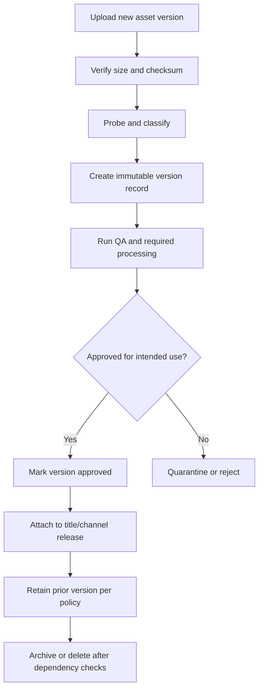
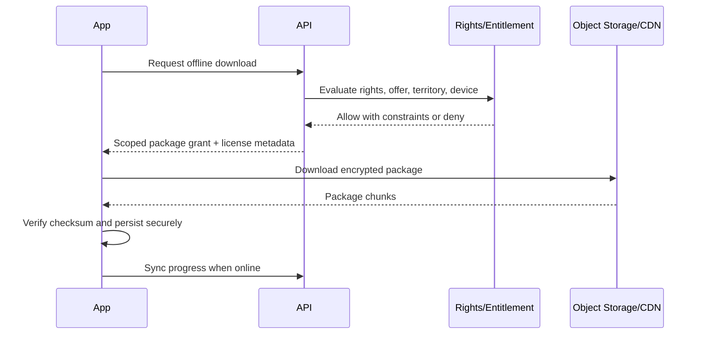

# ViewAura System Architecture — Non-MVP Target Architecture

**Document status:** Proposed post-MVP architecture  
**Product:** ViewAura  
**Version:** 1.0 — Non-MVP scope  
**Date:** 23 November 2026  
**Relationship to MVP:** Extends the MVP architecture. It assumes the core Go modular monolith, PostgreSQL, upload pipeline, rights-aware offers, payment/entitlement flow and HLS playback are operational. This document describes target extensions, not existing implementation.

---

## 1. Architectural intent

The post-MVP architecture turns ViewAura into a multi-tenant film operations and distribution platform. It extends the existing architecture rather than replacing it.

The key architectural rule is that all distribution surfaces must share canonical title, asset, rights, offer, entitlement and playback policy. A studio storefront, ViewAura marketplace, embedded player, screener portal and institutional channel must not each implement their own authorization logic.

### 1.1 Preserve the existing foundation

- Go modular monolith remains the transactional product core.
- PostgreSQL remains the system of record.
- Kafka remains the asynchronous event backbone where operationally justified.
- Temporal orchestrates long-running media, rights, retention and financial workflows.
- Object storage holds media bytes; database rows hold metadata and policy.
- CDN/edge delivers authorized media without proxying video through the API.
- Rust/Python satellites remain workload-specific, not one service per business domain.
- Native clients own protected offline storage and device-bound playback integration.

The source README describes existing modules and infrastructure, but also identifies incomplete workflow activities, scaffolded satellites, incomplete BFF functionality, absent DRM/Flink and thin tests. Every new capability below requires implementation and verification.

## 2. Logical architecture extensions

```text
                         PRODUCT SURFACES
  Studio Console | ViewAura Watch | Branded Storefront | Embed Player
  Screener Portal | Festival/Institution Portal | Partner API
                              |
                       Edge / API Gateway
                              |
                    Go Modular Monolith
  -------------------------------------------------------------------
  Studio/Tenant | Catalog | Rights | Offers | Channels | Entitlements
  Assets/Vault  | Screeners | Playback | Payments | Revenue Ledger
  Audience      | Campaigns | Notifications | Moderation | Audit
  -------------------------------------------------------------------
           |                  |                    |
       PostgreSQL         Transactional       Policy decisions
       system of record   outbox/events       and scoped grants
           |                  |
           |                Kafka
           |                  |
           |       --------------------------------------
           |       Analytics | Search | Recommendations
           |       Notifications | Partner adapters
           |
  Media Object Storage <--- Temporal workflows ---> Media workers
  originals, versions,     ingest, QA, rights,     FFmpeg/package,
  screeners, subtitles,    publish, retention,     watermark,
  HLS renditions, exports  deletion, reconciliation subtitle/localize
           |
       CDN / Edge authorization
           |
     HLS / DASH where justified
           |
    Web / PWA / Native clients

  Offline path:
  entitlement + device registration -> download grant -> encrypted
  package -> local license enforcement -> offline progress queue
  -> idempotent synchronization after reconnect
```

## 3. New and expanded domain boundaries

Keep these as modules in the Go monolith until measured scaling or team ownership justifies extraction.

| Domain | Responsibility | Owns |
|---|---|---|
| Studio/Tenant | Multi-tenant workspace and team access | studios, memberships, roles, workspace settings |
| Asset/Vault | Asset metadata, versions, lifecycle and access | asset versions, checksums, storage references, retention |
| Rights | Rights evidence and permitted exploitation | rights holders, territories, windows, channels, restrictions |
| Distribution | External channel configuration | storefronts, embeds, partner channels, channel policies |
| Offer | Commercial access terms | price, currency, offer windows, bundles, promo rules |
| Entitlement | Authoritative access decision | grants, group entitlements, device/session policy |
| Screener | Invitation-based review access | campaigns, recipients, access grants, feedback |
| Audience | Follow graph and consented studio relationship | follows, preferences, consent, suppression |
| Campaign | Campaign metadata and attribution | campaign links, promo codes, source attribution |
| Revenue | Financial ledger and settlement state | transactions, fees, refunds, splits, payout reconciliation |
| Institution | Bounded group/event access | institutions, events, seats, group policies |
| Analytics | Aggregated business and playback metrics | projections and aggregates; not transactional truth |
| Audit | Security and business audit history | actor, action, target, reason, timestamp, correlation |

### 3.1 Tenant isolation

Every studio-owned resource must carry a tenant/studio scope. Authorization must verify both membership and role at the service layer; never trust a client-supplied `studio_id` as proof of access.

- Repository queries must scope by tenant.
- Unique constraints should include tenant where identifiers are tenant-local.
- Background jobs must carry tenant context.
- Signed object keys and grants must be scoped to asset and tenant.
- Cross-tenant administrative access must use explicit audited operator privileges.
- Add automated IDOR and tenant-isolation tests for every new endpoint.

### 3.2 Canonical title and asset identity

A catalog title is not an asset. One title can have many assets and versions. A distribution offer points to a title and a policy; a playback package points to an approved asset version.

Do not duplicate the title for each channel. Keep relationships explicit:

`Studio -> Title Workspace -> Canonical Title -> Rights -> Offer -> Channel -> Entitlement -> Playback Package`

Asset lineage:

`Asset -> Asset Version -> Processing Job -> Rendition/Derivative -> Publication Reference`

Replacing a master creates a new version and an explicit release decision. It must not silently replace a live package.

## 4. Data model additions

The following are conceptual entities; inspect the actual migration history before creating or renaming tables.

### 4.1 Studio and access

- `studios`
- `studio_memberships`
- `studio_roles`
- `studio_role_permissions`
- `studio_invitations`
- `studio_workspaces`
- `studio_audit_events`

### 4.2 Asset vault

- `media_assets`
- `media_asset_versions`
- `media_asset_derivatives`
- `media_asset_links`
- `media_asset_access_grants`
- `media_asset_checksums`
- `media_asset_retention_policies`
- `media_asset_legal_holds`
- `media_asset_audit_events`

Store object keys and metadata, not media bytes, in PostgreSQL. Object keys should be opaque and non-guessable. Keep originals private. Use separate storage namespaces or policy boundaries for originals, screeners, published renditions, offline packages and exports.

### 4.3 Rights and distribution

- `rights_holders`
- `title_rights`
- `rights_evidence`
- `rights_windows`
- `rights_restrictions`
- `distribution_channels`
- `distribution_channel_configs`
- `distribution_offers`
- `offer_prices`
- `offer_territories`
- `offer_windows`
- `release_schedules`
- `offer_entitlements`
- `distribution_partner_credentials`

Rights are policy inputs, not merely descriptive metadata. An offer must not override a restriction.

### 4.4 Screener and institution

- `screener_campaigns`
- `screener_recipients`
- `screener_access_grants`
- `screener_view_events`
- `screener_feedback`
- `institutions`
- `institution_memberships`
- `institution_events`
- `group_entitlements`
- `institution_access_sessions`

### 4.5 Audience, campaign and revenue

- `studio_follows`
- `audience_consents`
- `audience_suppressions`
- `audience_segments`
- `campaigns`
- `campaign_links`
- `campaign_attributions`
- `transactions`
- `transaction_line_items`
- `refunds`
- `revenue_splits`
- `payouts`
- `payout_reconciliations`

Audience exports must be generated from an explicit allowlist and include consent/legal-basis state. Do not make arbitrary profile tables directly exportable.

## 5. Rights and entitlement policy engine

Rights evaluation is a central platform boundary. Every access surface calls the same policy service.

### 5.1 Decision inputs

- User/account/profile status.
- Studio/title publication status.
- Applicable rights holder and evidence status.
- Territory and current rights window.
- Permitted use and distribution channel.
- Offer state, price/payment status and entitlement grant.
- Device/client capability and offline policy.
- Screener invitation or institution/group grant, where applicable.
- Session expiry, revocation and concurrency limits.

### 5.2 Policy outcomes

Return a structured decision: `allow`, `deny`, or `allow_with_constraints`.

Constraints can include maximum resolution, download permission, device count, expiry, concurrency, watermark profile, territory, allowed embed domains and offline validity.

### 5.3 Revocation

A rights change or access revocation must:
1. Commit the policy change and audit event.
2. Emit a versioned domain event through the outbox.
3. Invalidate relevant cached decisions and renewals.
4. Stop issuing new playback/download grants.
5. Revoke active sessions where supported.
6. Mark offline licenses for revocation/expiry at the next supported client contact; offline revocation cannot be guaranteed while a device is disconnected.
7. Re-evaluate affected offers, embeds, screeners and institution access.

Do not claim instant revocation of a fully offline device that cannot receive a revocation message. Use short license validity windows appropriate to the content risk.

## 6. Media vault architecture

### 6.1 Storage classes

| Class | Examples | Access and lifecycle |
|---|---|---|
| Original | Camera/master source | Private; owner/authorized post-production only; long retention |
| Mezzanine | Approved high-quality master | Private; processing and distribution workers |
| Derivative | HLS renditions, thumbnails, previews | Policy-scoped; CDN delivery as appropriate |
| Screener | Recipient-watermarked review copy | Private; invitation-bound and expiring |
| Offline package | Encrypted device download | Device-bound license; expiry/revocation policy |
| Archive | Cold originals and inactive versions | Restore workflow; legal hold aware |
| Export | Reports, manifests and audience exports | Short-lived signed access; audited |

### 6.2 Version and lifecycle workflow



Deletion must be dependency-aware. A scheduled deletion workflow checks legal holds, active screeners, published releases, current offers and restoration windows before removing object bytes.

### 6.3 Integrity and audit

- Verify checksum after upload and after storage migration where feasible.
- Record object version, checksum algorithm and verification timestamp.
- Audit sensitive reads as well as writes for high-risk assets.
- Never log signed URLs, screener tokens or download license secrets.
- Use short-lived scoped download grants.
- Apply lifecycle rules only after the application state transition succeeds.

## 7. Screener security architecture

A screener is an access policy and audit workflow, not simply a private URL.

1. Studio creates campaign and recipient records.
2. Recipient is verified or authenticated according to risk.
3. Entitlement service issues a scoped grant with expiry and restrictions.
4. Playback session obtains recipient-bound authorization.
5. Watermark worker produces visible/forensic marks according to policy.
6. Playback events are associated with campaign and recipient identifiers.
7. Studio can revoke the grant and inspect access history.

Client-side screenshot prevention is not reliable across all devices. Watermarking, access controls, recipient identity, contractual terms and audit reduce risk but do not guarantee prevention of copying.

## 8. Multi-channel distribution

### 8.1 Channel adapter contract

Each adapter should implement a thin contract:

- Validate channel configuration.
- Validate supported offer and media requirements.
- Publish/unpublish or provision access.
- Return channel-side identifier and status.
- Receive delivery/status callbacks where supported.
- Report usage and settlement data where available.

The adapter must not independently decide rights. It requests policy decisions from the canonical rights/entitlement domain.

### 8.2 Embed player

- Domain allowlist and configurable branding.
- Playback session created through canonical API.
- Short-lived signed cookie/token scoped to title, package and domain.
- No public object bucket or permanent manifest URL.
- Embed analytics are aggregated and purpose-limited.
- Origin/CDN cache key must not permit cross-user private content leakage.

### 8.3 Branded storefront

Use a shared storefront renderer and tenant configuration rather than a bespoke frontend deployment per studio. Support custom domain mapping only after domain verification, TLS provisioning and abuse controls.

## 9. Audience and campaign architecture

### 9.1 Permissioned audience model

A follow is not blanket marketing consent. Model separately:
- Follow relationship.
- Topic/channel notification preference.
- Marketing consent where required.
- Suppression/unsubscribe state.
- Legal basis and consent evidence where applicable.

Outbound delivery checks suppression and preference at send time, not only when a campaign is drafted.

### 9.2 Campaign attribution

Use first-party campaign identifiers and event correlation:
`campaign impression/click -> storefront visit -> offer view -> checkout -> transaction -> aggregate playback outcome`.

Avoid unrestricted cross-site tracking and unnecessary collection of personal identifiers. Deduplicate events and define attribution windows transparently.

### 9.3 Audience export

- Export is role-gated and purpose-scoped.
- Generate from an allowlisted projection, not arbitrary SQL.
- Exclude users without a permitted basis.
- Include export timestamp, requesting actor, filters and policy version in audit.
- Apply expiry to generated files and signed access.
- Support correction/deletion requests in downstream export workflows where legally required.

## 10. Commerce, ledger and payout architecture

The payment provider is not the internal financial ledger.

- Record immutable transaction and line-item facts.
- Record provider event IDs and enforce webhook idempotency.
- Model refunds, chargebacks, taxes, platform fees and rights-holder/partner shares as separate ledger entries.
- Reconcile provider settlement against internal transactions.
- Keep payout state distinct from purchase entitlement.
- Do not revoke a legitimate entitlement merely because a payout batch is delayed; apply explicit fraud/chargeback policy.
- Use durable workflows for payout preparation and reconciliation, with manual exception handling.

## 11. Offline and resilient distribution

### 11.1 Client responsibilities

A supported native client must:
- Register a device and protect device credentials.
- Store downloaded media encrypted in app-controlled storage.
- Bind licenses to device and title/package.
- Enforce expiry and supported playback policy.
- Verify package integrity before playback.
- Queue permitted progress and engagement mutations with idempotency keys.
- Synchronize on reconnect and resolve conflicts deterministically.

A browser/PWA may cache metadata and selected non-protected assets, but must not be represented as providing the same protected offline video guarantees as a native secure-download implementation.

### 11.2 Download authorization flow



### 11.3 Local caching/community distribution

This is conditional, not a default platform dependency. Before implementation, validate:
- Rights to serve copies from a local cache.
- Encryption and key custody.
- Audience authentication and local-network isolation.
- Usage metering and reporting.
- Cache invalidation and expiry.
- Cost advantage versus ordinary CDN delivery.
- Operational support responsibilities at the venue.

## 12. Analytics architecture

### 12.1 Event pipeline

Transactional domain changes publish through the outbox. Kafka transports events to analytical consumers. Analytics stores are projections and never replace PostgreSQL as the financial or entitlement source of truth.

Suggested event families:
- `studio.events`
- `asset.events`
- `rights.events`
- `distribution.events`
- `offer.events`
- `screener.events`
- `audience.events`
- `campaign.events`
- `commerce.events`
- `payout.events`
- `playback.events`
- `offline.events`
- `institution.events`

Events should include event ID, schema version, occurred-at timestamp, tenant/studio ID where applicable, actor class, entity ID, correlation ID and minimal required payload. Do not place credentials, signed URLs or unnecessary personal data in events.

### 12.2 Analytics projections

- Studio performance by title, channel, territory and release window.
- Campaign funnel and attributable transactions.
- Playback quality by client, rendition, network class and geography at suitable aggregation.
- Cost by stored GB-month, processed source hour, delivered viewing hour and tenant.
- Screener invitation/access/completion funnel.
- Revenue ledger and payout reconciliation projections.

Use ClickHouse or another analytical store when event volume and query needs justify it. Begin with Postgres aggregates or managed analytics if that is cheaper and sufficient.

## 13. API surface extensions

Illustrative REST resources; align names with existing route conventions and OpenAPI contracts.

| Domain | Example endpoints |
|---|---|
| Vault | `POST /studios/{id}/assets/{asset}/versions`, `GET /studios/{id}/assets/{asset}/versions`, `POST /assets/{id}/archive` |
| Retention | `GET/PATCH /studios/{id}/retention-policies`, `POST /assets/{id}/legal-hold` |
| Screeners | `POST /studios/{id}/screener-campaigns`, `POST /screener-campaigns/{id}/recipients`, `POST /screener-grants/{id}/revoke` |
| Channels | `POST /studios/{id}/channels`, `POST /titles/{id}/embeds`, `PATCH /embeds/{id}` |
| Rights | `GET /studios/{id}/rights/expiring`, `POST /titles/{id}/rights-windows` |
| Campaigns | `POST /studios/{id}/campaigns`, `GET /campaigns/{id}/performance` |
| Audience | `POST /studios/{id}/audience-segments`, `POST /studios/{id}/audience-exports` |
| Commerce | `POST /studios/{id}/bundles`, `GET /studios/{id}/revenue/reconciliation` |
| Institution | `POST /institutions/{id}/events`, `POST /events/{id}/group-entitlements` |
| Offline | `POST /titles/{id}/download-grants`, `POST /devices/{id}/offline-sync` |
| Analytics | `GET /studios/{id}/analytics/title-performance`, `GET /studios/{id}/analytics/costs` |

Every route requires tenant scoping, role authorization, validation, rate limits, audit where sensitive and idempotency for mutations that can be retried.

## 14. Security and privacy controls

- Tenant isolation tests and authorization policy tests.
- Short-lived signed access and scoped object paths.
- Key management and rotation through a secret manager/KMS.
- Encryption at rest and in transit.
- No public access to original masters or screener objects.
- Domain allowlists for embeds.
- Device registration and offline license expiry.
- Audit logs for asset reads, rights changes, exports, screener access and financial operations.
- Consent/suppression checks at outbound delivery time.
- Data retention and deletion workflows.
- Abuse controls for partner API credentials.
- Security review before launching watermarking, offline downloads, external embeds or audience exports.

## 15. Reliability, operations and cost controls

### 15.1 Failure isolation

Playback must not depend synchronously on analytics, recommendation, email or campaign reporting. If those systems are unavailable, core authorization and playback continue.

Asset processing, deletion, rights reevaluation and payout reconciliation use durable workflows with idempotent activities, bounded retries, dead-letter/manual review paths and compensation where safe.

### 15.2 Cost dimensions

Track:
- Stored GB-month by storage class and tenant.
- Processing minutes/source hour and generated rendition count.
- CDN egress/delivered viewing hour by title/channel.
- Watermarking and subtitle processing cost.
- Analytics ingestion and query cost.
- Offline package storage and delivery.
- Support and operational effort per active studio.

Use quotas, lifecycle policies, rendition ladders based on source quality, CDN caching, cold storage and per-plan limits. Do not generate every codec/resolution combination by default.

### 15.3 Scale triggers

Do not introduce Kubernetes, service extraction, multi-CDN, multi-region active-active, local caches or advanced DRM solely because they appear in a future-state diagram. Define a measurable trigger: throughput, latency, team ownership, contractual SLA, security requirement or positive unit economics.

## 16. Implementation sequence after MVP

### Phase A — Vault and screener operations
1. Add immutable asset versions and lineage.
2. Implement checksum verification and retention policy.
3. Add legal hold and dependency-aware deletion.
4. Implement screener campaigns, recipient grants, expiry and revocation.
5. Add watermarking only for validated screener use cases.
6. Complete access audit and security tests.

### Phase B — External distribution
1. Build shared embed playback authorization.
2. Add domain verification and embed configuration.
3. Build branded storefront configuration and custom-domain lifecycle.
4. Add channel adapter interface and first validated partner integration.
5. Add channel-level reporting.

### Phase C — Audience and commercial intelligence
1. Complete consent and suppression model.
2. Build audience segments and scoped export.
3. Implement campaign attribution and conversion funnel.
4. Build revenue ledger, refunds, splits and payout reconciliation.
5. Add studio cohort and title-economics dashboards.

### Phase D — Advanced commerce and institutions
1. Add bundles, memberships, early access and paid premieres.
2. Add institution/event entities and group entitlements.
3. Add seat/concurrency/time/territory restrictions.
4. Add institutional reporting and settlement workflows.

### Phase E — Offline and localization
1. Select supported native client platforms.
2. Implement device-bound licenses and encrypted storage.
3. Add resumable downloads, storage/data budgets and integrity verification.
4. Add offline progress synchronization.
5. Add subtitle/audio localization workflows and review states.

### Phase F — Network effects and scale
1. Improve editorial discovery and cross-studio recommendations.
2. Add festival/partner APIs and more channel adapters.
3. Evaluate local caching with a controlled institution pilot.
4. Evaluate multi-CDN/advanced DRM from measured requirements.
5. Scale analytics and service boundaries from production evidence.

## 17. Architecture decisions and unresolved validations

| Decision | Default | Revisit when |
|---|---|---|
| Backend boundaries | Go modular monolith | Independent scaling/team ownership is measurable |
| Analytics | Postgres aggregates initially; ClickHouse when justified | Query volume or retention needs exceed current store |
| Video processing | Managed service or existing FFmpeg worker based on unit economics | Encoding volume/control requirements change |
| DRM | Integrate established DRM only for licensed device/partner requirements | Rights contracts require it |
| Offline | Native clients only for protected downloads | Supported client and rights policy are validated |
| Local cache | Do not build initially | Institution pilot demonstrates legal and economic benefit |
| Custom domains | Shared storefront with verified domain mapping | Operational support and tenant scale justify automation |
| Recommendations | Editorial + behavioral baseline | Enough consented interaction data exists to validate lift |
| Service extraction | Avoid premature microservices | Profiling/team ownership demonstrates need |

## 18. Exit criteria

The non-MVP architecture is considered mature only when:
- All product surfaces use the same rights and entitlement policy.
- Tenant isolation is covered by automated tests.
- Asset versions and retention are dependency-aware and auditable.
- Screener access is recipient-scoped, expiring and revocable for online authorization.
- Embeds cannot bypass access control or leak private CDN cache entries.
- Audience exports enforce consent, scope and audit.
- Revenue reports reconcile to payment provider settlement.
- Institution access is bounded by contract, time, territory and audience policy.
- Offline downloads are supported only on explicitly tested clients with enforceable license rules.
- Analytics outages do not block playback or transactional correctness.
- Cost per studio/title/viewing hour is measurable and reviewed.
